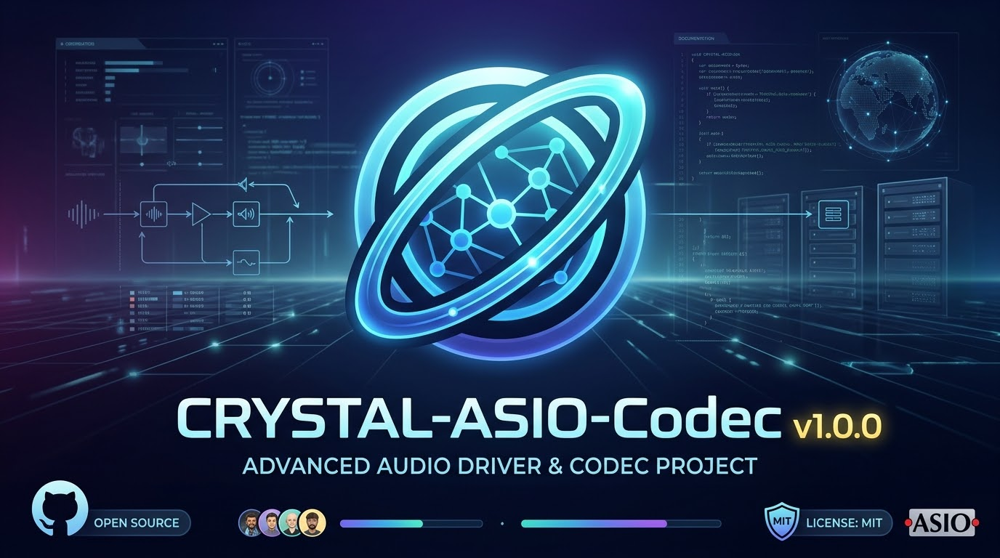

Copyright © 2026 Lewis James Seals Jr. All rights reserved.
THE SOFTWARE IS PROVIDED "AS IS", WITHOUT WARRANTY OF ANY KIND,
EXPRESS OR IMPLIED, INCLUDING BUT NOT LIMITED TO THE WARRANTIES OF
MERCHANTABILITY, FITNESS FOR A PARTICULAR PURPOSE AND
NONINFRINGEMENT.

<p align="center">
  
</p>

# <p align="center">CRYSTAL-ASIO-Codec v1.0.0</p>
<p align="center"><strong>Advanced Cross-Platform Real-Time Audio Driver & Codec</strong></p>

<p align="center">
  
  
  
  
</p>

---

## 🌟 Overview

**Crystal-ASIO-Codec** is a high-performance, low-latency cross-platform audio driver and streaming codec designed for professional audio engineering environments. Built from the ground up with **C++20**, it prioritizes rigorous real-time safety, deterministic execution, and complete privacy with **zero telemetry** or tracking SDKs.

---

## ⚙️ Core Architecture & Components

* **Opus Codec Integration (`src/opus_codec.cpp`)**: High-efficiency audio compression and decompression for streaming workflows.
* **Real-Time Guard (`src/rt_guard.cpp`)**: Protects audio callback threads against priority inversions, blocking operations, and allocation.
* **Lock-Free Audio Ring Buffer (`src/audio_ring_buffer.cpp`)**: Thread-safe buffering optimized for multi-track scaling and low-latency.
* **Sample Conversion & Channel Mapping (`src/sample_convert.cpp`, `src/channel_map.cpp`)**: Flexible routing and format conversions for varied hardware layouts.
* **Telemetry Diagnostics (`src/telemetry.cpp`)**: Localized performance metrics capture without external data transmission.

---

## 🖥️ Platform Backends

* **Windows (`src/windows/`)**: 
  * Full ASIO driver implementation (`crystal_asio_driver.cpp`).
  * WASAPI audio hardware backend (`wasapi_backend.cpp`).
* **macOS (`src/macos/`)**: 
  * CoreAudio HAL plugin integration (`crystal_hal_plugin.cpp`).
  * Automated installation helper scripts (`scripts/install_macos.sh`).

---

## 📁 Repository Structure

```text
Crystal-ASIO-Codec-v1.0.0/
├── CMakeLists.txt              # Root CMake build configuration
├── LICENSE                     # MIT License
├── README.md                   # Project documentation
├── docs/                       # Architecture & SDK integration guides
├── include/crystal/            # Public header files
├── scripts/                    # Platform deployment scripts
├── src/                        # Implementation source files
│   ├── macos/                  # macOS CoreAudio HAL components
│   └── windows/                # Windows ASIO & WASAPI components
└── tests/                      # Unit test suites

```
## 🚀 Building from Source
Ensure you have a **C++20** compatible compiler and **CMake** installed.
```bash
# Clone the repository
git clone [https://github.com/ljrseals-dev/Crystal-Codec-Newton.git](https://github.com/ljrseals-dev/Crystal-Codec-Newton.git)
cd Crystal-Codec-Newton

# Configure and build
cmake -B build -DCMAKE_BUILD_TYPE=Release
cmake --build build --config Release

```
## 📄 Documentation
Detailed documentation and integration notes are available under the docs/ directory:
 * Architecture Design
 * ASIO SDK Integration
 * macOS Setup Guide
 * Build Status & Gates
## 📝 License
This project is open-source software licensed under the **MIT License**.
```

```
